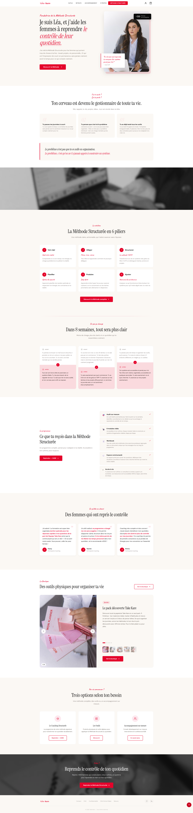
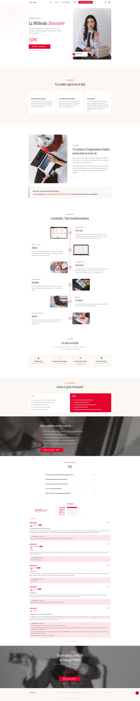
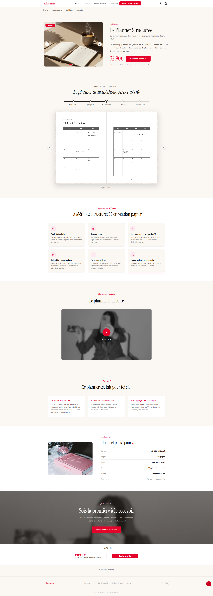

# Take Kare — Wellness & Mindfulness Shopify Store

> **Live Website:** [https://takekare.co/](https://takekare.co/)

---

## 📌 Project Overview

**Take Kare** is a French wellness and lifestyle brand dedicated to helping women regain balance and intentionality in their daily lives. The brand offers coaching programs (**La Méthode Structurée**), personal development tools (**Le Planner Structuré**), and holistic wellness retreats.

During my tenure at my previous agency, this client project was assigned to me. I served as the **Shopify Frontend Theme Developer**, responsible for turning design concepts and functional requirements into a fast, responsive, and high-converting Shopify Online Store 2.0 implementation.

---

## 🛠️ My Role & Responsibilities

As the dedicated theme developer for this project, my work included:

- **Shopify OS 2.0 Theme Development:** Architecting modular sections and blocks based on modern Shopify standards.
- **Custom Liquid Architecture:** Developing custom Liquid templates and snippets for unique brand features (coaching methodology presentation, retreat bookings, and interactive components).
- **Single-Product Landing Experience:** Building an engaging, conversion-optimized showcase for *Le Planner Structuré*.
- **Responsive Layout & Mobile-First Design:** Ensuring seamless performance and typography across desktop, tablet, and mobile devices.
- **Multilingual Support:** Structuring JSON schema settings and localization files (locales/) for French language presentation.
- **Performance & Polish:** Streamlining CSS and JavaScript assets for fast page load times and fluid micro-interactions.

---

## 💻 Tech Stack

- **Platform:** Shopify Online Store 2.0
- **Templating:** Liquid, JSON Templates
- **Frontend:** HTML5, CSS3 / Custom Styles, Modern JavaScript (ES6+)
- **Base Framework:** Minimog Framework (extensively customized)
- **Tools:** Shopify Theme Architecture, Git

---

## 📂 Theme Structure

\\\	ext
├── assets/         # CSS styles, JS libraries, and brand visual assets
├── blocks/         # Custom Shopify 2.0 app and theme blocks
├── config/         # Theme settings data and schema (settings_schema.json)
├── layout/         # Base layout wrappers (theme.liquid, password.liquid)
├── locales/        # Language strings (French & English localization)
├── sections/       # Dynamic, modular section components
├── snippets/       # Reusable Liquid snippets (cards, icons, badges)
├── templates/      # JSON templates for products, collections, pages, and blogs
└── screenshots/    # Visual previews of the storefront
\\\

---

## 📸 Storefront Previews

| Homepage Hero & Overview | Coaching Program (*La Méthode Structurée*) |
| :---: | :---: |
|  |  |

| Wellness Retreat Page | Product Showcase (*Le Planner Structuré*) |
| :---: | :---: |
|  |  |

---

## ⚖️ Disclaimer

All brand assets, copy, imagery, and trademarks belong to **Take Kare** ([takekare.co](https://takekare.co)). This repository is presented solely to showcase my individual frontend development contributions, custom Liquid theme engineering, and technical implementation completed for the client.
